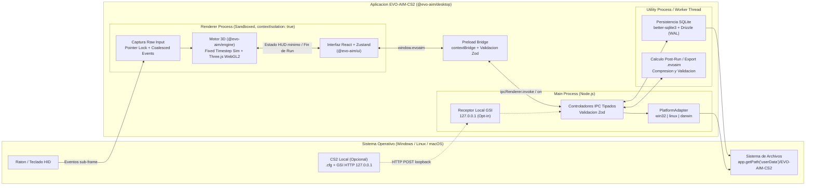
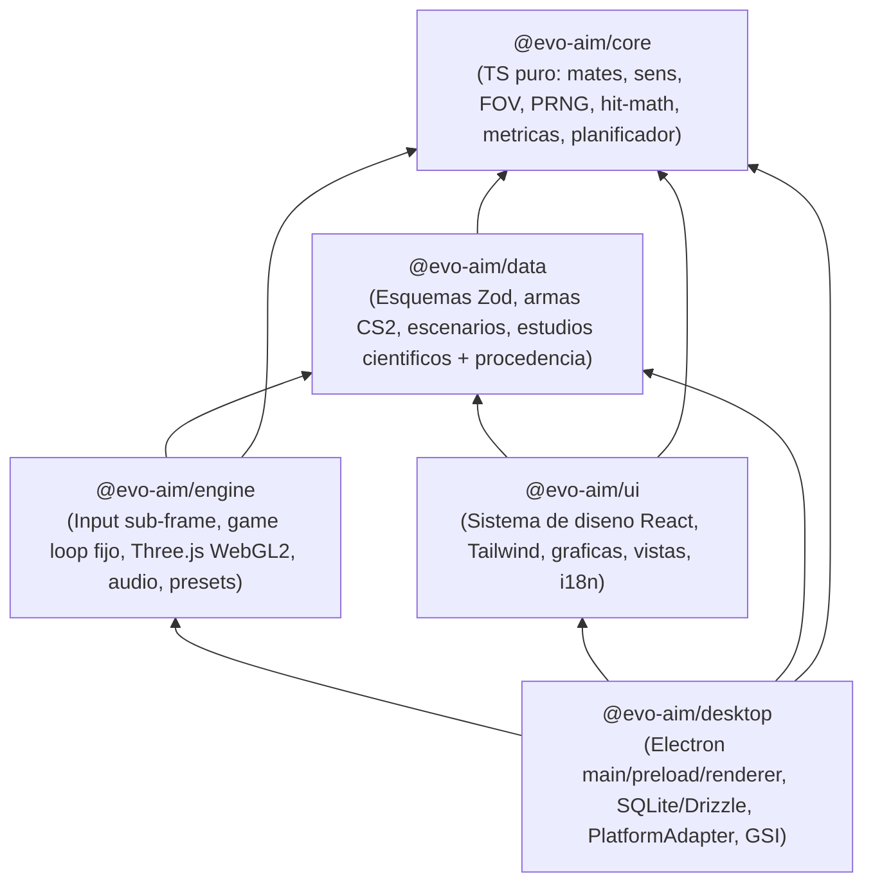
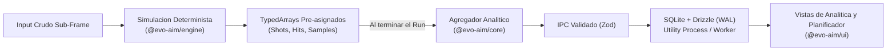

# ARCHITECTURE.md — Arquitectura del Sistema EVO-AIM-CS2

- **Propósito:** Definir la arquitectura técnica accionable del monorepo EVO-AIM-CS2: procesos de Electron, regla unidireccional de dependencias, adaptadores multiplataforma (`PlatformAdapter`), tubería de input crudo sub-frame, game loop determinista invariante a FPS, persistencia SQLite, contratos IPC y seguridad.
- **Fecha:** 2026-11-13
- **Versión:** 1.0.0
- **Estado:** Accepted

---

## 1. Visión Arquitectónica General

**EVO-AIM-CS2** es una aplicación de escritorio local (_offline-first_, cero telemetría por defecto) construida sobre **Electron + TypeScript strict + Vite + React + Zustand + Tailwind CSS + Three.js (WebGL2) + SQLite (`better-sqlite3` + Drizzle ORM)** organizada en un monorepo `pnpm` (véanse `ADR-0001` a `ADR-0004`).

Tres invariantes gobiernan toda la arquitectura:

1. **Núcleo puro desacoplado (`@evo-aim/core`):** todas las fórmulas de sensibilidad, FOV, PRNG, cinemática, evaluación de impacto geométrico, métricas estadísticas y planificación adaptativa son funciones deterministas en TypeScript puro, sin dependencias de DOM, WebGL, React, Node ni Electron. Si en el futuro un spike aconsejase cambiar Electron por un shell nativo (`Rust + wgpu`), `@evo-aim/core` y `@evo-aim/data` se reutilizan intactos.
2. **Invarianza de fidelidad de aim respecto a FPS (`ADR-0012`):** la integración de entrada de ratón y la resolución de disparos operan sobre marcas de tiempo sub-frame y simulación de paso fijo, separadas de la tasa de refresco visual y del preset gráfico.
3. **Aislamiento total del Sistema Operativo (`ADR-0011`):** ningún paquete ni módulo fuera de `apps/desktop/src/main/platform/{win32,linux,darwin}` conoce detalles de Windows, Linux o macOS.

---

## 2. Arquitectura de Procesos en Electron



### Qué vive en cada proceso y por qué

- **Renderer Process (`sandbox: true`, `nodeIntegration: false`, `contextIsolation: true`):** aloja la interfaz React (`@evo-aim/ui`) y el canvas WebGL2 de Three.js junto con el bucle de simulación en tiempo real (`@evo-aim/engine`). Mantener captura de ratón, simulación y renderizado en el mismo contexto evita cruzar IPC en cada milisegundo (cero latencia añadida en el _hot path_).Durante un run activo, React suspende re-renders globales y el HUD ligero se actualiza de forma directa/aislada.
- **Preload Script:** superficie mínima expuesta mediante `contextBridge.exposeInMainWorld('evoaim', Object.freeze(...))`. No expone `ipcRenderer` crudo ni APIs de Node; valida argumentos y respuestas con Zod antes de entregarlos al renderer.
- **Main Process:** gestiona el ciclo de vida de ventanas, políticas de seguridad (CSP, bloqueo de navegación), diálogos nativos de archivos, `PlatformAdapter` (`win32`, `linux`, `darwin`), auto-actualizaciones y el receptor HTTP local opcional de GSI (`127.0.0.1`).
- **Utility Process (`Electron.utilityProcess`) / Worker Thread:** ejecuta `better-sqlite3` (síncrono en C++) y el empaquetado/validación de archivos `.evoaim` o agregaciones analíticas pesadas fuera del hilo principal de Main y completamente fuera del Renderer, garantizando que **jamás bloqueen el hot path ni congelen la ventana** (`QB-10`). _(En Capa 3 se validará si basta un `Worker` de Node o `utilityProcess` de Electron según compatibilidad con `better-sqlite3` en `SPIKE-4`)._

---

## 3. Dependencias entre Paquetes del Monorepo

Regla estricta de grafo acíclico dirigido (DAG) unidireccional:



_(Justificación respecto a la relación `UI` y `Engine`: `@evo-aim/ui` contiene componentes React puros, pantallas de analítica, menús y widgets de HUD desacoplados de WebGL2 para poder testearse rápido en Vitest/jsdom sin inicializar un contexto WebGL2 real, mientras que `@evo-aim/desktop` monta el `EngineCanvas` de `@evo-aim/engine` junto con las vistas de `@evo-aim/ui`. Ni `core` ni `data` importan jamás de capas superiores)._

### Responsabilidades y Restricciones por Paquete

| Paquete                | Ruta              | Responsabilidad y API pública prevista                                                                                                                                                                                                                                                                                                              | Restricciones estrictas (enforced por ESLint)                                                                                                                                                                              |
| ---------------------- | ----------------- | --------------------------------------------------------------------------------------------------------------------------------------------------------------------------------------------------------------------------------------------------------------------------------------------------------------------------------------------------- | -------------------------------------------------------------------------------------------------------------------------------------------------------------------------------------------------------------------------- |
| **`@evo-aim/core`**    | `packages/core`   | Fórmulas de sensibilidad (`eDPI`, `cm/360`, `yaw/pitch`), proyecciones FOV (`Hor+`), PRNG con semilla, geometría de intersección rayo-esfera/cápsula, modelo cinemático de movimiento/dispersión, cálculo de métricas (TTK, Fitts, overshoot), motor de rutinas adaptativas, contratos IPC base / metadatos `DataProvenance` y tipo `Result<T, E>`. | **Única dependencia de runtime permitida: `zod`** (esquemas puros isomórficos). Prohibido importar `window`, `document`, `fs`, `path`, `electron`, `three`, `react`, `Math.random()` o `Date.now()`. Cobertura $\ge 95\%$. |
| **`@evo-aim/data`**    | `packages/data`   | Esquemas Zod compartidos (incluyendo contratos IPC y formato `.evoaim`), metadatos obligatorios de procedencia (`DataProvenance`), catálogo de armas/recoil de CS2, escenarios base, rutinas base y biblioteca científica verificada.                                                                                                               | Solo depende de `@evo-aim/core` y `zod`. Prohibido incluir datos sin metadatos de `DATA_POLICY.md` o binarios pesados.                                                                                                     |
| **`@evo-aim/engine`**  | `packages/engine` | Gestor de Pointer Lock e input sub-frame, bucle de simulación determinista de timestep fijo, escena Three.js WebGL2 (`InstancedMesh`), escalado dinámico de resolución (DRS), presets Bajo/Medio/Alto/Ahorro, audio procedural/baja latencia y grabador/reproductor de replays.                                                                     | Depende de `@evo-aim/core`, `@evo-aim/data` y `three`. Prohibido importar `electron`, `fs`, `better-sqlite3` o `react`. Cero asignaciones dinámicas en el hot path (`QB-08`).                                              |
| **`@evo-aim/ui`**      | `packages/ui`     | Componentes visuales reutilizables (Tailwind), pantallas de menús, gráficas de analítica post-run, calibrador interactivo, editor visual de escenarios, onboarding y sistema i18n (ES/EN + comunidad).                                                                                                                                              | Depende de `@evo-aim/core`, `@evo-aim/data`, `react`, `zustand` y utilidades UI permisivas. Prohibido acceder a Node/Electron directamente (recibe callbacks/puertos inyectados).                                          |
| **`@evo-aim/desktop`** | `apps/desktop`    | Aplicación Electron completa: `main`, `preload`, montaje del `renderer`, persistencia SQLite + Drizzle, `PlatformAdapter` (`win32`, `linux`, `darwin`), importación/exportación `.evoaim`, receptor GSI local y configuración de `electron-builder`.                                                                                                | Único paquete autorizado a usar APIs de Electron, Node.js y `better-sqlite3`. Código específico del SO restringido exclusivamente a `src/main/platform/*`.                                                                 |

---

## 4. Estructura Completa del Monorepo (Objetivo Capa 1+)

```text
evo-aim-cs2/
├── .github/
│   ├── ISSUE_TEMPLATE/
│   │   ├── bug_report.yml
│   │   ├── data_correction.yml
│   │   ├── feature_request.yml
│   │   └── config.yml
│   ├── workflows/                  # (Capa 1+) CI multi-OS (win/linux/mac), license-check, release
│   ├── CODEOWNERS
│   ├── PULL_REQUEST_TEMPLATE.md
│   ├── dependabot.yml
│   └── labels.yml
├── apps/
│   └── desktop/                    # @evo-aim/desktop (Electron shell)
│       ├── src/
│       │   ├── main/
│       │   │   ├── ipc/            # Handlers IPC validados con Zod
│       │   │   ├── platform/       # ÚNICO lugar con código dependiente del SO
│       │   │   │   ├── types.ts    # Interfaz PlatformAdapter
│       │   │   │   ├── index.ts    # Factory por process.platform
│       │   │   │   ├── win32/      # Win32PlatformAdapter (Steam reg, paths, DPI)
│       │   │   │   ├── linux/      # LinuxPlatformAdapter (XDG/Steam/Wayland/X11)
│       │   │   │   └── darwin/     # DarwinPlatformAdapter (macOS best-effort)
│       │   │   ├── persistence/    # Worker/Utility SQLite + Drizzle + migraciones + backups
│       │   │   ├── gsi/            # Servidor HTTP 127.0.0.1 opt-in para CS2 GSI
│       │   │   └── security/       # CSP, bloqueo de navegación y permisos
│       │   ├── preload/            # contextBridge mínimo tipado
│       │   └── renderer/           # Composición de @evo-aim/ui + @evo-aim/engine
│       └── electron-builder.yml
├── packages/
│   ├── core/                       # @evo-aim/core (matemáticas puras, RNG, sim rules, métricas)
│   ├── data/                       # @evo-aim/data (Zod schemas, catálogos con fuente, .evoaim)
│   ├── engine/                     # @evo-aim/engine (raw input, fixed loop, Three.js, DRS)
│   └── ui/                         # @evo-aim/ui (React, Zustand, Tailwind, gráficas, i18n)
├── e2e/                            # Tests end-to-end con Playwright para Electron
├── tools/                          # Scripts internos (auditoría de licencias, validación de datos, benchmarks)
├── docs/                           # Documentación de arquitectura, políticas y ADRs
│   └── adr/                        # Architecture Decision Records (0001..0014+)
├── AGENTS.md
├── CODE_OF_CONDUCT.md
├── CONTRIBUTING.md
├── GOVERNANCE.md
├── LICENSE
├── PROGRESS.md
├── README.md
├── SECURITY.md
├── SUPPORT.md
└── THIRD_PARTY_NOTICES.md
```

---

## 5. Abstracción Multiplataforma (`PlatformAdapter`)

Para cumplir con [`docs/PLATFORM_SUPPORT.md`](./PLATFORM_SUPPORT.md) y `ADR-0011`:

- **Regla inquebrantable:** queda prohibido invocar comandos o APIs dependientes del sistema operativo (lectura del Registro de Windows, separadores `\\`, variables `%APPDATA%` manuales, asunciones sobre X11/Wayland) fuera de `apps/desktop/src/main/platform/{win32,linux,darwin}`. Una regla personalizada de ESLint (`no-restricted-imports` / `no-restricted-syntax`) vigilará esto desde la Capa 1.
- Todas las rutas internas de la aplicación se construyen exclusivamente mediante `app.getPath('userData')` (subcarpeta `EVO-AIM-CS2`) y el módulo estándar `node:path`.
- **Contrato previsto de `PlatformAdapter`:**
  - `getPlatformDiagnostics()`: devuelve SO, release, arquitectura, sesión gráfica detectada en Linux (`x11` | `wayland` | `unknown`), factor de escala de pantalla y soporte reportado.
  - `locateSteamInstallation()`: busca Steam de forma segura según el SO o devuelve `null` sin lanzar excepciones.
  - `locateCs2Paths()`: localiza `game/csgo/cfg` y carpetas de `userdata/730` parseando `libraryfolders.vdf`, devolviendo `Result<Cs2Paths, PlatformError>`.
  - `installGsiConfig(cfgContent)` / `removeGsiConfig()`: gestiona `gamestate_integration_evoaim.cfg` tras confirmación explícita del usuario.
- **Degradación elegante (Capa 16):** si `locateCs2Paths()` devuelve no encontrado (p. ej. PC sin CS2 instalado o macOS), las funciones de sincronización de `.cfg` y GSI se muestran como deshabilitadas/informativas y el resto de la aplicación opera al 100 %.

---

## 6. Estrategia de Input Crudo y Precisión Sub-Frame

### 6.1 Captura con Pointer Lock y `unadjustedMovement`

Al iniciar un escenario 3D, `@evo-aim/engine` solicita:

```text
canvas.requestPointerLock({ unadjustedMovement: true })
```

- **Camino óptimo:** el navegador/Electron entrega deltas de ratón directamente desde el subsistema HID sin aceleración del sistema operativo.
- **Fallback controlado:** si la promesa rechaza con `NotSupportedError` (posible en ciertos compositores Linux Wayland o versiones concretas de macOS; véase `SPIKE-6`), el motor reintenta `canvas.requestPointerLock()` estándar, marca el run en sus metadatos con `rawInputVerified: false` y muestra un aviso no intrusivo pero inequívoco en el HUD y en la pantalla de calibración.

### 6.2 Acumulación Sub-Frame con `getCoalescedEvents()`

A tasas de sondeo altas (1000 Hz, 4000 Hz, 8000 Hz), el navegador agrupa varios informes USB HID dentro de un único despacho por frame. Leer solo `event.movementX` en el evento agregado perdería la trayectoria intermedia y la marca temporal exacta previa a un clic:

1. En cada `pointermove`, el motor invoca `event.getCoalescedEvents()` (con fallback al propio `event` si la lista viene vacía).
2. Cada evento elemental $(\Delta x_i, \Delta y_i, t_i)$ y cada botón `pointerdown` / `pointerup` $(b_j, t_j)$ se escriben en un **Ring Buffer pre-asignado sobre `Float64Array` / `Int32Array`** (capacidad fija para $\ge 16\,384$ muestras por frame, cero asignaciones en el heap).

### 6.3 Tratamiento de DPI Scaling del Sistema (`R2`)

En ciertas combinaciones de SO y escala de pantalla (p. ej. Windows al 125 % o 150 %, o Wayland con _fractional scaling_), existe el riesgo histórico en Chromium de que `movementX/Y` llegue dividido o multiplicado por `window.devicePixelRatio` o truncado.

- **Experimento de detección (`SPIKE-1` y `SPIKE-6`):** inyectar mediante herramienta externa/prueba física controlada exactamente $K$ _counts_ con escala del SO al 100 %, 125 %, 150 % y 200 %, verificando si `movementX` es entero idéntico a $K$ bajo `unadjustedMovement: true`.
- **Salvaguarda en producto:** detectar si llegan deltas fraccionarios no enteros y cruzarlo en el asistente de calibración 360° (Capa 9) para alertar o aplicar factor de corrección auditado únicamente si un bug de plataforma demostrado lo exige.

---

## 7. Game Loop, Resolución Sub-Frame e Invarianza respecto a FPS

```mermaid
sequenceDiagram
  participant HID as Ring Buffer Input 125-8000 Hz
  participant Loop as Engine Frame Tick rAF
  participant Sim as Simulacion Fija 240 Hz
  participant Hit as Evaluador Sub-Frame de Disparo
  participant WebGL as Three.js Renderer y DRS

  HID->>Loop: Eventos ordenados por timeStamp
  Loop->>Sim: Avanzar pasos fijos dt = 1/240 s con tope anti-spiral
  Sim->>Hit: Integrar vista hasta t_shot e interpolar blancos en t_shot
  Hit-->>Sim: Registrar impacto exacto y actualizar estado determinista
  Sim-->>WebGL: Interpolar estado visual alpha = accumulator / dt
  WebGL-->>Loop: Renderizar con preset activo y medir frameTime para DRS
```

1. **Separación Simulación vs. Render:**
   - La simulación avanza en pasos discretos fijos $\Delta t_{\text{sim}} = 1 / 240\text{ s}$ ($4.1667\text{ ms}$) usando un acumulador de tiempo.
   - El renderizado ocurre en `requestAnimationFrame` (o temporizador limitado si hay _FPS Cap_) interpolando linealmente las transformaciones de los objetivos móviles con $\alpha = \text{accumulator} / \Delta t_{\text{sim}} \in [0, 1)$ para eliminar cualquier _judder_ visual en monitores de 60, 144, 240 o 360 Hz.
2. **Resolución exacta del disparo (_Sub-frame Hitscan_):**
   - La rotación de la cámara por ratón se integra cronológicamente evento por evento según sus timestamps $t_i$. Cuando aparece un evento `shoot` en $t_{\text{shot}}$, la mira tiene exactamente los _counts_ acumulados hasta $t_{\text{shot}}$, y la posición de cada objetivo se evalúa en el tiempo exacto de simulación correspondiente a $t_{\text{shot}}$. Por eso un jugador a 30 o 60 FPS obtiene **exactamente el mismo resultado de impacto** que a 360 FPS (`QB-06`).
3. **Política anti-_espiral de la muerte_ (_Anti-Spiral of Death_):**
   - Si el proceso sufre un bloqueo puntual del SO (p. ej. alt-tab pesado de 500 ms), el delta máximo acumulado por frame se recorta a un tope seguro (p. ej. $100\text{ ms} = 24\text{ ticks}$) o entra automáticamente en pausa limpia si la ventana pierde el foco (`blur` / salida de `pointerlockchange`).
4. **Pausa y Resume deterministas:**
   - Al perder Pointer Lock o pulsar pausa, el reloj de simulación congela inmediatamente su acumulador, descarta deltas espurios de re-entrada del cursor y reanuda tras una breve cuenta atrás opcional.

---

## 8. Escalabilidad Gráfica en `@evo-aim/engine`

De acuerdo con [`docs/HARDWARE_TIERS.md`](./HARDWARE_TIERS.md):

- **Detección inicial:** comprobación de WebGL2, lectura de renderer GPU (con alerta si se detecta renderizado por software como `SwiftShader` o `llvmpipe`) y benchmark de 10 s durante el primer arranque para preseleccionar el preset (`Modo Ahorro`, `Bajo`, `Medio`, `Alto`), siempre bloqueable por el usuario.
- **Cero basura en WebGL:** todas las mallas de dianas/bots se pre-instancian al cargar el escenario (`THREE.InstancedMesh`), los _decals_ de impacto usan un buffer circular fijo y las matrices temporales (`Matrix4`, `Vector3`, `Ray`) son instancias estáticas reutilizadas fuera del bucle.
- **Escalado Dinámico de Resolución (DRS):** ajusta `renderer.setPixelRatio` del canvas 3D cuando `frameTime` se acerca al límite del monitor, mientras que el _crosshair_ y el HUD permanecen en una capa superpuesta a resolución nativa para que la mira jamás se vea borrosa en equipos Tier L.

---

## 9. Determinismo y Formato de Replay

1. **PRNG con semilla (`ADR-0005`):** se empleará un generador determinista rápido y auditable implementado en `@evo-aim/core` (p. ej. `xoshiro128**` o `splitmix32`/`mulberry32` operando sobre enteros de 32 bits sin pérdida de precisión en IEEE-754 `number` de JS). Todo spawn, trayectoria aleatoria y variación controlada consume de instancias aisladas del PRNG inicializadas con la `seed` del run.
2. **Prohibiciones en simulación:** prohibido `Math.random()`, `Date.now()`, `performance.now()` directo dentro de las reglas de simulación (el tiempo entra como parámetro explícito) e iteración sobre estructuras sin orden garantizado.
3. **Orden estable de actualización:** cada tick ejecuta estrictamente: `(1) drenar eventos de input ordenados -> (2) actualizar cinemática jugador/arma -> (3) actualizar spawners y movimiento de blancos por ID ascendente -> (4) resolver disparos/colisiones -> (5) evaluar fin de escenario y emitir telemetría en buffer pre-asignado`.
4. **Trigonometría no determinista entre versiones de V8 (`ADR-0005`, `ADR-0016`, `SPIKE-3`):** las funciones trascendentales IEEE-754 de la librería estándar (`Math.sin`, `Math.cos`, `Math.atan2`, `Math.acos`) **no tienen garantía bit-exacta en ECMAScript** entre distintas versiones de V8/FDLIBM ni entre el runtime de **Node 22 (`22.22.3`)** donde corren los tests unitarios de Vitest y el runtime de **Electron `45.3.2` (Chromium `156.0.8078.100`)** donde corren la simulación en vivo y los replays. Cualquier diferencia de `1 ULP` acumulada durante miles de ticks podría desviar una colisión límite (`hit`/`miss`). Por ello, en la **Capa 4 (`SPIKE-3`)** las trayectorias y rotaciones críticas del bucle determinista utilizarán tablas/polinomios trigonométricos deterministas propios en `@evo-aim/core` (o versiones de runtime fijadas y verificadas extremo a extremo en CI).
5. **Replays deterministas (`.evoaim`):** un replay almacena únicamente `{ engineVersion, scenarioId, scenarioHash, seed, sensitivityConfig, quantizedInputStream }` (unos pocos KB comprimidos por minuto), permitiendo reproducir cualquier partida con coste mínimo de disco.

---

## 10. Flujo de Datos y Persistencia Local



- **Estrategia SQLite (`ADR-0004`):** archivo de base de datos único en `<userData>/EVO-AIM-CS2/data/evoaim.sqlite` con `PRAGMA journal_mode = WAL;`, `PRAGMA synchronous = NORMAL;` y `PRAGMA foreign_keys = ON;`.
- **Escritura por lotes fuera del hot path (`QB-10`):** durante los 60 s de un ejercicio no se realiza **ninguna** consulta ni escritura a disco. Al concluir el run, el resumen de métricas, los eventos de disparo y el blob compacto del replay se insertan en **una única transacción atómica** en el proceso secundario.
- **Migraciones y copias de seguridad:** migraciones SQL versionadas gestionadas con Drizzle; antes de aplicar cualquier migración de esquema al actualizar la app, se realiza automáticamente una copia de seguridad rotativa (`backups/evoaim-pre-vX.Y.Z.sqlite.bak`).

---

## 11. Estrategia IPC y Modelo de Seguridad en Electron

### 11.1 Contratos IPC Tipados con Zod

Todos los canales IPC base del sistema (`app:getInfo`, `diag:nativeModules`) y los futuros canales de dominio se definen en contratos compartidos validados con **Zod** (`@evo-aim/core` para diagnósticos base de aplicación y `@evo-aim/data` para catálogos/persistencia a partir de la Capa 3). Tanto el puente `preload` (`window.evoaim`) como el despachador central de `ipcMain.handle` validan el payload entrante y saliente con Zod y comprueban `event.senderFrame` (solo frame principal y origen `app://evoaim`), rechazando cualquier mensaje malformado o de origen no confiable (`QB-12`, `ADR-0017`).

### 11.2 Endurecimiento de Electron (`SECURITY_MODEL.md`, `ADR-0017`)

- `contextIsolation: true`, `sandbox: true`, `nodeIntegration: false`, `nodeIntegrationInWorker: false`, `nodeIntegrationInSubFrames: false`, `webSecurity: true`, `allowRunningInsecureContent: false`, `webviewTag: false`.
- **Content Security Policy (CSP) estricta en producción (cero `unsafe-eval` y cero `unsafe-inline`):** `default-src 'none'; script-src 'self'; style-src 'self'; img-src 'self' data:; font-src 'self'; connect-src 'self'; object-src 'none'; base-uri 'none'; form-action 'none'; frame-ancestors 'none'` (relajada exclusivamente en modo desarrollo local para el servidor HMR de Vite).
- **Protocolo personalizado `app://evoaim` y Electron Fuses:** prohibido usar `file://` en producción; `protocol.handle('app', ...)` sirve los archivos estáticos de `out/renderer` bloqueando `..`, `%2e%2e`, `%5c` y bytes nulos. En el empaquetado (`afterPack`), `@electron/fuses` desactiva `RunAsNode`, `EnableNodeOptionsEnvironmentVariable` y `EnableNodeCliInspectArguments` y exige validación de integridad ASAR.
- **Bloqueo total de navegación, permisos y ventanas externas:** denegación por defecto en `setPermissionRequestHandler` / `setPermissionCheckHandler`, e interceptación de `will-navigate` y `setWindowOpenHandler` permitiendo abrir en navegador externo únicamente URLs HTTPS de la lista blanca (`https://github.com/EvoMaxPC/evo-aim-cs2`).

---

## 12. Estrategia de Testing, CI Multiplataforma y Observabilidad

- **Pirámide de Testing (`TESTING_STRATEGY.md`):**
  1. _Unit & Property-based tests_ (`Vitest` + `fast-check`) para `@evo-aim/core` y `@evo-aim/data`.
  2. _Tests de Determinismo e Invarianza FPS_ (`QB-05`, `QB-06`) alimentando trazas sintéticas al bucle de `@evo-aim/engine` a 30/60/144/360 FPS.
  3. _Tests de Integración_ para SQLite + Drizzle + migraciones y adaptadores `PlatformAdapter` con sistemas de archivos simulados/temporales.
  4. _Tests E2E_ (`Playwright` contra Electron) verificando arranque, navegación, ejecución de un escenario corto y persistencia.
  5. _Benchmarks automatizados_ (`vitest bench`) vigilando cero regresiones en funciones críticas.
- **Matriz de CI Planificada (Capa 1+):**
  - `windows-latest` (Tier 1, bloqueante completo).
  - `ubuntu-latest` (Tier 2, bloqueante en lint/typecheck/unit/build nativo y E2E básico).
  - `macos-latest` (Tier 3, informativo / no bloqueante `continue-on-error: true`).
  - Job dedicado de auditoría de licencias permisivas y validación de esquemas de `DATA_POLICY.md`.
- **Observabilidad respetuosa con la privacidad:**
  - Logging estructurado JSON rotativo local en `<userData>/EVO-AIM-CS2/logs/` con niveles `error | warn | info | debug`.
  - Sanitización automática de rutas de usuario (`<USER_HOME>`) en los logs para que un usuario pueda adjuntarlos en un Issue público sin filtrar su nombre personal.
  - **Cero telemetría remota por defecto** (`ADR-0014`).

---

## 13. Spikes Técnicos de Riesgo

Antes de consolidar la implementación completa del motor y el empaquetado, la arquitectura exige superar 6 experimentos empíricos con criterios binarios de éxito/fallo y Plan B definidos en [`docs/RISKS_AND_SPIKES.md`](./RISKS_AND_SPIKES.md):

- **`SPIKE-4` (Capa 1):** compilación y empaquetado de `better-sqlite3` en Electron para Windows x64 y Linux x64.
- **`SPIKE-1` (Inicio Capa 4):** fidelidad de `unadjustedMovement`, `getCoalescedEvents()` hasta 8000 Hz y ausencia de distorsión por DPI scaling frente a `cm/360`.
- **`SPIKE-2` (Inicio Capa 4):** _frame pacing_ a 144–360 Hz y cero pausas de GC en Three.js + Electron.
- **`SPIKE-3` (Capa 2 / Inicio Capa 4):** determinismo del PRNG y de la simulación entre ejecuciones y entre Windows/Linux.
- **`SPIKE-5` (Inicio Capa 4):** viabilidad de rendimiento a 60 Hz estables en hardware real **Tier L** (iGPU) con preset Bajo y DRS.
- **`SPIKE-6` (Sonda ligera en Capa 1 + validación en Inicio Capa 4):** comportamiento real de input crudo entre sistemas operativos (Windows, Linux X11, Linux Wayland y macOS).
