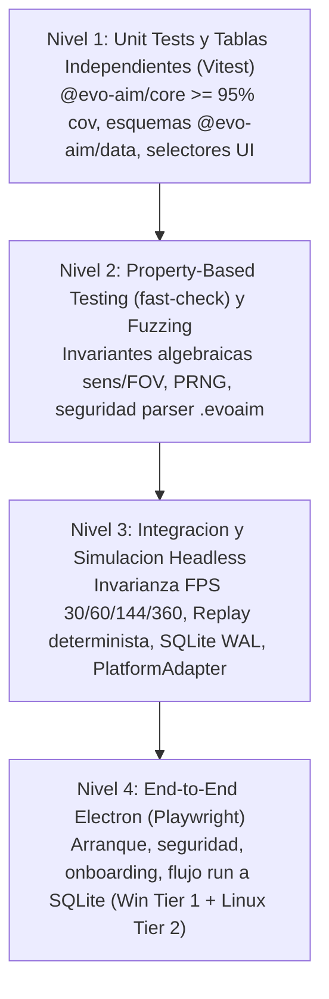

# TESTING_STRATEGY.md — Estrategia Integral de Pruebas y Verificación

- **Propósito:** Definir la pirámide de testing, herramientas, pruebas de propiedades matemáticas, validación de determinismo, invarianza respecto a FPS, eventos sintéticos de ratón y pruebas E2E multiplataforma en EVO-AIM-CS2.
- **Fecha:** 2026-11-13
- **Versión:** 1.0.0
- **Estado:** Accepted

---

## 1. Pirámide de Pruebas en EVO-AIM-CS2



### Herramientas seleccionadas (se instalan en Capa 1)

- **Runner unitario, integración y benchmarks:** `Vitest` (`vitest run`, `vitest --coverage` con proveedor `v8`, `vitest bench`).
- **Property-based testing:** `fast-check` para demostrar invariantes sobre miles de entradas generadas aleatoriamente con semilla reproducible.
- **UI de componentes aislados:** `@testing-library/react` sobre componentes desacoplados en `@evo-aim/ui`.
- **End-to-End de escritorio:** `Playwright` (`_electron.launch()`) ejecutándose en CI sobre `windows-latest` (completo) y `ubuntu-latest` (básico con servidor gráfico virtual).

---

## 2. Cómo Probamos las Matemáticas con Valores de Referencia Independientes

Un error clásico al probar código matemático generado por humanos o IA es copiar la misma fórmula del código fuente dentro del test (tautología). En EVO-AIM-CS2 se exige **verificación por oráculo independiente**:

1. **Tablas de verdad precalculadas externamente:** para `eDPI`, `cm/360`, `countsPer360`, `Hor+ FOV` e intersección rayo-esfera, los casos de prueba usarán tablas de valores exactos derivados analíticamente a mano / aritmética simbólica independiente (documentando la derivación en comentarios del test) con tolerancia estricta $\varepsilon = 10^{-9}$.
2. **Invariantes algebraicas con `fast-check`:**
   - _Invertibilidad:_ $\text{cm360ToSens}(\text{sensToCm360}(s, \text{dpi}), \text{dpi}) \approx s$ para todo $\text{dpi} \in [100, 32000], s \in [0.01, 20]$.
   - _Invarianza por escala eDPI:_ duplicar `DPI` y dividir `sens` por 2 produce **exactamente** el mismo `cm/360` y `eDPI`.
   - _Monotonía:_ aumentar `sens` manteniendo `DPI` constante reduce estrictamente `cm/360`; aumentar la relación de aspecto ($4:3 < 16:10 < 16:9 < 21:9$) incrementa estrictamente el `hFOV` bajo escalado `Hor+`.

---

## 3. Pruebas de Determinismo (`QB-05`) e Invarianza de FPS (`QB-06`)

### 3.1 Determinismo Cross-Run y Cross-OS

El núcleo de simulación en `@evo-aim/engine` expondrá un modo _headless_ puro (sin necesitar tarjeta gráfica real para las reglas de simulación):

- Dado `{ scenarioConfig, seed, inputEventTrace }`, ejecutar el motor dos veces seguidas o en `windows-latest` vs. `ubuntu-latest` debe producir el **mismo hash SHA-256** del resumen de impactos, posiciones en el instante del disparo y puntuación final (`SPIKE-3`).

### 3.2 Test Obligatorio de Invarianza respecto a FPS (`QB-06`)

A partir de la Capa 4, un test bloqueante en CI ejecutará un mismo flujo sintético de 60 segundos con cientos de movimientos sub-frame (con timestamps a resolución de $0.125\text{ ms}$, equivalente a 8000 Hz) y 120 disparos sobre objetivos móviles bajo cuatro configuraciones del reloj de renderizado:

- **30 FPS** ($\Delta t_{\text{render}} = 33.33\text{ ms}$)
- **60 FPS** ($\Delta t_{\text{render}} = 16.67\text{ ms}$)
- **144 FPS** ($\Delta t_{\text{render}} = 6.94\text{ ms}$)
- **360 FPS** ($\Delta t_{\text{render}} = 2.78\text{ ms}$)

**Criterio de paso:** la lista de disparos `(shotIndex, hitBoolean, targetId, angularErrorDeg)` y el `baseScore` deben ser **idénticos** en las cuatro ejecuciones.

---

## 4. Validación del Input de Ratón con Eventos Sintéticos (`QB-02`, `QB-03`)

Dado que en CI no hay mano humana moviendo un ratón físico de 8000 Hz:

1. **Generador de flujos sintéticos HID/PointerEvent:** construimos un emisor determinista que genera ráfagas de objetos `PointerEvent` simulando `getCoalescedEvents()` a **125 Hz, 1000 Hz, 4000 Hz y 8000 Hz**, incluyendo casos borde:
   - Frame largo de $25\text{ ms}$ con 200 eventos coalescidos de 8000 Hz acumulados en un solo despacho.
   - Evento `pointerdown` ocurrido exactamente a mitad de frame entre dos movimientos rápidos (_flick-shot_ balístico).
   - Pérdida repentina de `PointerLock` (`Escape` o cambio de foco) en mitad de un movimiento.
2. **Verificación de conservación cero-pérdida:** el test comprueba que $\sum \text{countsProcesados} === \sum \text{countsEmitidos}$ (error = **0 counts**) y que el Ring Buffer no realiza asignaciones dinámicas ni desborda silenciosamente.

---

## 5. Pruebas de Persistencia, Seguridad y Fuzzing

- **SQLite + Migraciones (Capa 3):** cada test levanta una base SQLite aislada en directorio temporal, aplica todas las migraciones Drizzle desde cero, verifica restricciones de clave foránea y comprueba que un backup previo a migración se restaura limpiamente si una migración simulada falla.
- **Seguridad Electron (Capa 1+):** test E2E en Playwright comprobando programáticamente que en el `renderer` `typeof window.require === 'undefined'`, `typeof process === 'undefined'`, que cualquier intento de navegar a `https://example.com` es bloqueado y que los canales IPC rechazan payloads inválidos.
- **Fuzzing de archivos `.evoaim` y `.cfg` (Capa 14 y 16):** `fast-check` alimenta al importador con JSONs truncados, números `NaN`/`Infinity`, cadenas gigantes, claves `__proto__` (_prototype pollution_) y rutas relativas `../../` garantizando rechazo limpio mediante `Result` tipado sin excepciones no controladas.

---

## 6. Benchmarks Continuos y Regresión de Memoria

- `vitest bench` medirá el coste por operación de las funciones calientes (conversión de input, paso de simulación de 240 Hz, intersección de rayos, serialización post-run).
- En la Capa 15 se añadirá un test automatizado de larga duración (soak test acotado en CI y completo de 10 min en pre-release) verificando ausencia de fugas de objetos Three.js (`renderer.info.memory.geometries` y `textures` constantes tras cargar y descargar escenarios 20 veces seguidas; `QB-08`).

---

## 7. Tests Parametrizados por Persona Sintética (`ADR-0018`, `QB-14`) — _Diseño para Capa 1.1_

> **Alcance documental:** Esta sección especifica la arquitectura de pruebas de adaptabilidad que **se implementará en código en la Capa 1.1** (`@evo-aim/core/testing` + `e2e/`). En la Capa 0.1 no se modifica código fuente.

### 7.1 Contrato `PersonaFixture` y Catálogo Inmutable

En `@evo-aim/core/testing` (módulo auxiliar exclusivamente de pruebas, nunca empaquetado en el _hot path_ de producción) se definirá un tipo inmutable `PersonaFixture` que refleje fielmente las **20 personas sintéticas (`P01`..`P20`)** de [`docs/PERSONAS_MATRIX.md`](./PERSONAS_MATRIX.md):

```text
interface PersonaFixture {
  readonly id: `P${string}`;                 // 'P01' .. 'P20'
  readonly syntheticDisclaimer: 'SINTÉTICA, no representa a ningún usuario real';
  readonly dpi: number;                      // [50, 64000] según SUPPORTED_RANGES.md
  readonly sensitivity: number;              // [0.01, 20.00]
  readonly pollingRateHz: 125 | 250 | 500 | 1000 | 2000 | 4000 | 8000;
  readonly display: {
    readonly width: number;
    readonly height: number;
    readonly refreshRateHz: number;
    readonly aspectMode: '4:3-native' | '4:3-stretched' | '16:9' | '16:10' | '21:9' | '32:9';
    readonly osScalePercent: 100 | 125 | 150 | 200 | 300;
  };
  readonly os: 'win32' | 'linux-wayland' | 'linux-x11' | 'darwin';
  readonly hardwareTier: 'L' | 'L-software' | 'M' | 'H';
  readonly distanceUnit: 'cm' | 'in';
  readonly mousepadWidthCm?: number;
  readonly keyboardLayout: 'QWERTY-ANSI' | 'QWERTY-ISO' | 'QWERTZ-ISO' | 'AZERTY-ISO';
  readonly accessibility: {
    readonly textScale: number;              // [0.85, 1.50]
    readonly reducedMotion: boolean;
    readonly forcedColors: boolean;
    readonly colorVisionMode: 'normal' | 'deuteranopia' | 'protanopia' | 'tritanopia';
    readonly keyboardOnlyUi: boolean;
    readonly screenReaderMode: boolean;      // P19 (NVDA/Narrator, VoiceOver, Orca)
    readonly reducedFineMotor: boolean;      // P18 (temblor / motricidad fina reducida)
    readonly leftHandedMouse: boolean;
  };
  readonly declaredSkillPrior: 'beginner-zero' | 'unranked' | 'low' | 'mid' | 'high' | 'pro';
  readonly historyProfile: 'empty' | 'consistent-short' | 'contradictory-short' | 'established-long';
}
```

### 7.2 Helper Parametrizado `forEachPersona`

Para evitar repetir bucles manuales en cada suite de Vitest, `@evo-aim/core/testing` expondrá un envoltorio declarativo `forEachPersona(testFn)` compatible con `it.each`:

- Ejecuta automáticamente la aserción recibida sobre las **20 personas (`P01`..`P20`)**, nombrando cada sub-caso con `[Pxx: resumen de ejes extremos]` para que cualquier fallo en CI señale al instante qué combinación de hardware/periférico/accesibilidad rompió la invariante.
- En pruebas de `@evo-aim/core` y `@evo-aim/data` (rápidas en memoria, $< 1\text{ ms}$ por persona), **se ejecutan siempre las 20 personas completas**.
- En pruebas E2E de ventana Electron con Playwright (`e2e/`), donde lanzar instancias completas tiene mayor coste temporal, un selector determinista `selectOrthogonalPersonas()` ejecuta el subconjunto mínimo que cubre todos los extremos visuales y de entrada (`P01` `720p@100 %` principiante, `P06` `4K@300 %` + `forced-colors` + `--text-scale: 1.5`, `P08` `reduced-motion` + tema claro, `P09` teclado-solo, `P10` `21:9` ultrawide, `P17` `5120x1440` `32:9`, `P18` motricidad reducida y `P19` lector de pantalla), pudiendo correr la matriz íntegra en pre-release.

### 7.3 Test Obligatorio de Cobertura de la Matriz (`matrix-coverage.test.ts`)

Un test unitario dedicado en la Capa 1.1 auditará el propio array `SYNTHETIC_PERSONAS` verificando automáticamente que:

1. Tiene tamaño **$\ge 14$** (actualmente `20`, `P01`..`P20`) y todos los IDs son únicos.
2. El 100 % de las entradas contiene literalmente `syntheticDisclaimer === 'SINTÉTICA, no representa a ningún usuario real'` y cae dentro de [`docs/SUPPORTED_RANGES.md`](./SUPPORTED_RANGES.md).
3. Ningún extremo obligatorio queda huérfano si alguien edita la matriz en el futuro: presencia verificada de `DPI <= 400` y `>= 16 000`, `pollingRateHz === 125` y `8000`, `refreshRateHz === 60` y `360`, `4:3-native`, `4:3-stretched`, `16:9`, `16:10`, `21:9`, `32:9`, `osScalePercent === 100`, `150` y `300`, `win32`, `linux-wayland`, `linux-x11`, `darwin`, unidades `'cm'` e `'in'`, `AZERTY-ISO`, `hardwareTier === 'L'`, `'beginner-zero'`, `'pro'` con `'established-long'`, `'contradictory-short'` (`ADR-0018` R3), daltonismo, `reducedMotion: true`, `forcedColors: true`, `keyboardOnlyUi: true`, `screenReaderMode: true` y `reducedFineMotor: true`.
